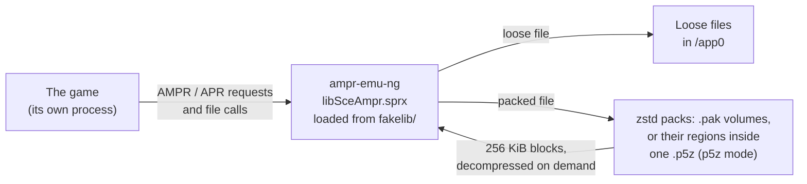
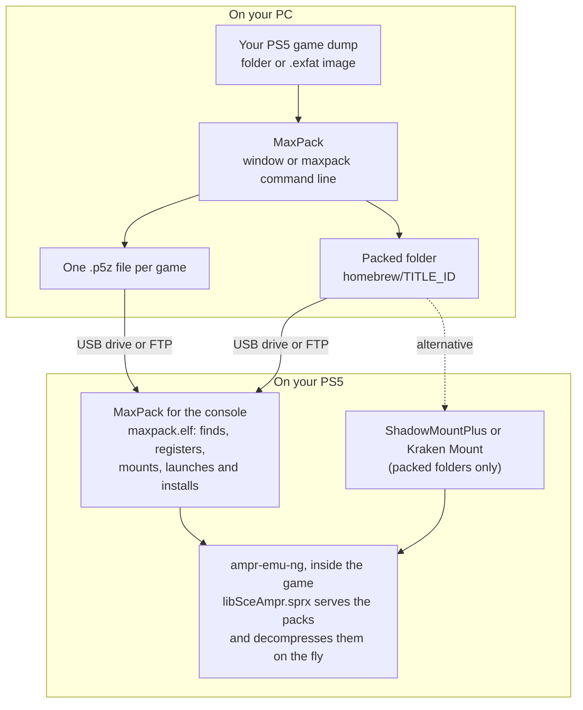

<h1 align="center">ampr-emu-ng <sub>(MaxPack's copy)</sub></h1>

<p align="center"><b>The runtime inside the game: it serves a PS5 game's packed files and decompresses them on the fly, now also straight from a single <code>.p5z</code> file.</b></p>

<p align="center">
  <a href="https://ko-fi.com/delfus77"></a>
  <a href="LICENSE"></a>
  <a href="https://github.com/DeLFuS77/ampr-emu-ng/releases"></a>
  <a href="https://github.com/DeLFuS77/ampr-emu-ng/actions/workflows/build.yml"></a>
  
</p>

<p align="center">
  <a href="https://github.com/DeLFuS77/ampr-emu-ng/releases/latest"><b>Download libSceAmpr.sprx</b></a> ·
  <a href="docs/p5z-mode.md"><b>The p5z mode</b></a> ·
  <a href="https://github.com/DeLFuS77/maxpack"><b>MaxPack for the PC</b></a> ·
  <a href="https://github.com/DeLFuS77/maxpack-ps5"><b>MaxPack for the console</b></a>
</p>



> [!NOTE]
> **Status: first public release, help us test.** MaxPack 1.0.0, with this build of ampr-emu-ng
> (`v0.5.1-maxpack.1`), is the first public release. It has been tested on one console (firmware
> 13.60) with a handful of games, so expect rough edges. Testing on other firmwares, games and drives
> is the most useful help right now: [here is how](#help-test-maxpack).

<p align="center">
  <a href="https://ko-fi.com/delfus77"></a>
  <br>
  <sub>❤️ Free and open source, and it will stay free. If it saves you time, a coffee helps keep it going.</sub>
</p>

ampr-emu-ng is a hard fork of [drakmor/ampr_emu](https://github.com/drakmor/ampr_emu), built by
quer3q to run PKG, zstd, LZ4 and plain games quickly and reliably. It is a replacement for the PS5
system library `libSceAmpr`, loaded from the game's own `fakelib/` folder.

**This repository is MaxPack's copy** of [quer3q/ampr-emu-ng](https://github.com/quer3q/ampr-emu-ng),
based on upstream **v0.5.1**. It follows upstream and adds exactly one mode, **p5z**: the zstd volumes
of a game are read straight from inside one `.p5z` file, so the PS5 needs no `.pak` files next to the
game. A game without a `maxpack.image` runs exactly as with upstream.

**Why the p5z mode matters.** It is what lets a PS5 game be played straight from one compressed `.p5z`
file. Nothing is unpacked, so the game keeps its saving (40–70 % on the games tested), and only its
small loose files go to the console's cache. On a real PS5 (firmware 13.60) it served games of 1, 9
and 19 volumes from the internal SSD and from an external M.2 SSD over USB-C, at about 2 ms per read
on the M.2 ([results](https://github.com/DeLFuS77/maxpack-ps5#tested-on-a-real-ps5)).

**What this is.** A library that runs inside each game, not an app you start. MaxPack for the console
bundles this build and puts it into the `fakelib/` of the games it mounts; you download it yourself
only for ShadowMountPlus, or to choose it in MaxPack for the PC. Everything but the p5z mode is
upstream's, quer3q's. **New to MaxPack? Start at the hub,**
[DeLFuS77/maxpack](https://github.com/DeLFuS77/maxpack): the PC app, the quick start and the guide.

## Contents

- [Why it exists](#why-it-exists)
- [The MaxPack family](#the-maxpack-family)
- [Features](#features)
- [Requirements](#requirements)
- [Quick start](#quick-start)
- [Documentation](#documentation)
- [FAQ](#faq)
- [Status](#status)
- [Build](#build)
- [Help test MaxPack](#help-test-maxpack)
- [Legal and disclaimer](#legal-and-disclaimer)
- [Credits and licence](#credits-and-licence)

## Why it exists

A PS5 game reads its data through the system library **`libSceAmpr`** (the AMPR and APR file APIs) and
through ordinary file calls. Run from a dump, it expects every file to be there, whole and
uncompressed. To keep a game **compressed and still playable**, something has to sit *inside the
game's process*, answer those requests from compressed packs and decompress only the blocks the game
asks for. That is ampr-emu-ng: a `no_std` Rust rewrite of drakmor's ampr_emu, which a mounter places
in the game's `fakelib/` so that the game loads it instead of the system's.

**Why MaxPack needs its own copy.** MaxPack keeps each game as a single `.p5z` file, which stores the
zstd volumes raw, byte for byte. To play that file *without unpacking it*, the runtime must read each
volume from its byte region inside the `.p5z` instead of from a separate `.pak` file. Upstream does not
have that mode, so this copy adds it, and only it: everything else is upstream's code, and new upstream
versions are followed.

## The MaxPack family

MaxPack is made of three projects that work together. Each one lives in its own repository and has
its own releases. The hub is [DeLFuS77/maxpack](https://github.com/DeLFuS77/maxpack): start there.



| Repository | Runs on | What it does |
|---|---|---|
| [**DeLFuS77/maxpack**](https://github.com/DeLFuS77/maxpack) | PC: Windows, macOS, Linux | Compresses a dump into zstd packs (one `.p5z` or a ready-to-play folder), verifies it and gives back the original bit for bit. Hosts the user guide. |
| [**DeLFuS77/maxpack-ps5**](https://github.com/DeLFuS77/maxpack-ps5) | PS5, as a payload | `maxpack.elf`: finds games, puts them on the home screen, mounts and launches them, plays a `.p5z` without unpacking it and installs games, from a web page on port 8095. |
| [**DeLFuS77/ampr-emu-ng**](https://github.com/DeLFuS77/ampr-emu-ng) | PS5, inside each game | `libSceAmpr.sprx`: answers the game's reads from the packs and decompresses them on the fly. MaxPack's copy adds the `p5z` mode. |

**Why three pieces?**

- **Compress on the PC, where it is fast.** Packing is heavy, multi-threaded work: a desktop CPU packs
  and checks a 133 GB game in under half an hour. It is done once, and the console never compresses
  anything.
- **The console only mounts and plays.** The payload finds games, registers them on the home screen
  and mounts them when they start. It does not rewrite the game, so a `.p5z` can stay on its USB
  drive as it is.
- **The runtime must live inside the game.** A PS5 game asks the system library `libSceAmpr` and the
  file system for its data. Only a library loaded into the game's own process, from its `fakelib/`
  folder, can answer those reads from compressed packs. That library is ampr-emu-ng, and it is a
  project of its own so that it also works under ShadowMountPlus and Kraken Mount.
- **Each piece follows its upstream.** The payload is based on quer3q's Kraken Mount and the runtime
  on quer3q's ampr-emu-ng. Keeping them apart keeps their history and their licences, and makes it
  easy to merge what upstream improves.

## Features

### One runtime, five modes

The mode is picked once, when the game starts, in this order: **pkg, p5z, zstd, lz4, plain**. The
console shows it in the launch notice, for example `ampr-emu-ng: v0.5.1 (p5z) running`.

| Mode | Picked when `/app0` has | Where the game's data comes from | Made or loaded by |
|---|---|---|---|
| `pkg` | `kraken.image` | A debug FPKG, read in place | Kraken Mount and MaxPack for the console (PKGs from PS5 Dump Forge) |
| **`p5z`** (this copy) | `maxpack.image` | zstd volumes read from their byte regions inside one `.p5z` | MaxPack for the console (`.p5z` from MaxPack for the PC) |
| `zstd` | `ampr_zstd.index` | `ampr_zstd-NNN.pak` volumes next to the game | MaxPack for the PC, PS5 Dump Forge |
| `lz4` | `ampr_assets.index` | `AMPRPAK4` packs | PS5 Dump Forge |
| `plain` | none of these | Loose files only | Any dump |

p5z comes right after pkg because a p5z game also has `ampr_zstd.index`, and would otherwise be taken
for a zstd game whose `.pak` files are missing. It is not a new format: the index, the mount, the caches
and the decoder are the zstd ones; only the place a volume is read from changes.

### The p5z mode

- **`maxpack.image`.** The payload that mounts the game writes this small text file into `/app0`: the
  `.p5z`'s path (`p5z/<name>`) and, for each volume, its id, start and length in bytes. It also mounts
  the folder that holds the `.p5z` read-only at `/app0/p5z/`.

  ```
  maxpack-image 1
  p5z/basic.p5z
  0 1234 5678
  ```

- **Everything checked before anything is served.** At start-up, before its hooks are installed, the
  runtime checks that `maxpack.image` parses (UTF-8, 1 to 256 volumes, at most 12 KiB, no control
  bytes), that the header of `ampr_zstd.index` is sound and names the same number of volumes, that
  the `.p5z` header and its CRC are right, that its archive id is the index's, that every volume region
  lies inside the file, and that each region starts with that volume's header.
- **No silent fallback.** If any check fails, no packed file is served (reads answer `EIO`) and the
  notice says why, for example `ampr-emu-ng: p5z: archive id mismatch; packed files not served`. It
  never switches to another mode on its own, which could serve the wrong data.
- **Same reads, one offset.** Every volume opens the `.p5z` as its own file descriptor and the kernel
  read adds the volume's region start, a 64-bit offset whose sums are checked and never wrap. Windows,
  caches, the read pool and kernel AIO work exactly as in zstd mode.
- **Your folder stays yours.** The folder mounted at `/app0/p5z/` may hold other games' `.p5z` files,
  so it is left out of the game's index: lookups there go to the file system.
- **Any file name.** A `.p5z` name may have accents, ™ or Japanese; it round-trips byte for byte.

Full specification: [docs/p5z-mode.md](docs/p5z-mode.md).

### From upstream

Everything else is quer3q's ampr-emu-ng v0.5.1, unchanged:

- A `no_std` Rust rewrite of drakmor's C++ ampr_emu. The PRX exports 137 symbols: 118 `sceAmpr*`
  functions and 19 libc/libc++ symbols that the system's `libSceAmpr` re-exports.
- zstd packs (`AMPRZPK1` index, `AMPRZDT1` volumes, 256 KiB blocks) decoded with libzstd; LZ4 packs
  (`AMPRPAK4`); debug FPKGs with their Kraken blocks.
- One compiled index view for every title, packed or not, built from its `ampr_emu.index`, so path
  lookups are answered from memory.
- A **writable `/app0`** when the game's folder is mounted read-write: the game can create and write
  its own files, while packed files stay read-only.
- A **debug build**, `libSceAmpr-debug.sprx`, with a metrics server on port 9090, a tuning file, a log
  of failed calls and a crash trace, for testing a game or a change.

### Releases

Releases of this copy are named `v<upstream version>-maxpack.<n>`, for example `v0.5.1-maxpack.1`:
the upstream version they are built on and a MaxPack revision. Each one carries `libSceAmpr.sprx`,
`libSceAmpr-debug.sprx` and `SHA256SUMS`. The launch notice shows the upstream part only.

- **Checked.** `sha256sum -c --ignore-missing SHA256SUMS` checks what you downloaded. From the release
  after `v0.5.1-maxpack.1` on, each file also has a GitHub build attestation that proves it was built by
  this repository's workflow from the tagged commit: `gh attestation verify libSceAmpr.sprx -R DeLFuS77/ampr-emu-ng`.
  `v0.5.1-maxpack.1` came before that step; its `libSceAmpr.sprx` is byte-identical to the one inside
  MaxPack for the console 1.0.0, whose `maxpack.elf` is attested.
- **Immutable.** Once a `v…-maxpack.N` release is published, its files cannot be replaced.
- **Pinned in MaxPack.** MaxPack for the console bundles a release's `libSceAmpr.sprx`, and its build
  checks that file against the release's `SHA256SUMS`.

Once this repository is published, every push to `main` also publishes both files as the `beta`
pre-release, whose notice reads `v<version>-beta.<commit>`.

## Requirements

- A **jailbroken PS5** with a mounter that loads the game's `fakelib/`:
  [MaxPack for the console](https://github.com/DeLFuS77/maxpack-ps5) (it bundles this build, and is
  the only one that sets up the p5z mode), ShadowMountPlus or Kraken Mount.
- Packed games from [MaxPack for the PC](https://github.com/DeLFuS77/maxpack) (zstd folders and
  `.p5z` files) or [PS5 Dump Forge](https://github.com/quer3q/ps5-dump-forge) (PKGs, zstd and LZ4
  packs). Other tools that write the same formats should work too, but are untested.
- To build it: Docker (see [Build](#build)).

## Quick start

**With MaxPack for the console:** nothing to do. `maxpack.elf` carries this build
(`v0.5.1-maxpack.2` from MaxPack for the console 1.0.2 on) and copies it into each game's `fakelib/`: always for `.pkg` and `.p5z` games,
and for folder games through a setting that is on by default.

**With ShadowMountPlus** (packed folders):

1. Download `libSceAmpr.sprx` and `SHA256SUMS` from
   [Releases](https://github.com/DeLFuS77/ampr-emu-ng/releases) and check the file
   ([how](#releases)).
2. Put it in the game's `fakelib/`: in MaxPack for the PC, choose it in **Settings** and pack the
   game (it goes into the `fakelib/` of games that do not carry one that reads zstd), or copy it there
   by hand.
3. In ShadowMountPlus, add or rescan the game and leave its fakelib mode on "Default (Full)".
4. Leave ShadowMountPlus's `auto_update_ampr` **off**: it would replace this runtime with the old
   ampr_emu, which does not read zstd packs.
5. Launch the game: the console says `ampr-emu-ng: v0.5.1 (zstd) running`.

**With Kraken Mount:** it puts its own ampr-emu-ng in the game's `fakelib/`, which reads zstd folders.
For a `.p5z`, use MaxPack for the console.

## Documentation

| Document | What is in it |
|---|---|
| [docs/p5z-mode.md](docs/p5z-mode.md) | The p5z mode: `maxpack.image`, mode order, start-up checks, reads and failures. |
| [docs/zstd-format.md](docs/zstd-format.md) | The zstd pack format (`ampr_zstd.index` and `ampr_zstd-NNN.pak`) and what a packer must keep. |
| [docs/writable-app0.md](docs/writable-app0.md) | How a writable `/app0` is detected and routed. |
| [docs/debug-build.md](docs/debug-build.md) | The debug build: metrics server, tuning file, op letters, black box. |
| [docs/read-path-tuning.md](docs/read-path-tuning.md) | Notes on tuning the read path. |
| [DESIGN.md](DESIGN.md) | Layout, memory budget, the PRX size rule, conventions and how a change is checked. |
| [CHANGELOG.md](CHANGELOG.md) | What changed in each release of this copy. |
| [SECURITY.md](SECURITY.md) | How to report a vulnerability, and what to know about a library that runs inside a game. |
| [MaxPack user guide](https://github.com/DeLFuS77/maxpack/blob/main/docs/guide.md) | The whole MaxPack workflow, PC and console. |

## FAQ

<details>
<summary><b>Do I need to download this?</b></summary>

Not with MaxPack for the console, which carries it. You need it only to play MaxPack's packed folders
with ShadowMountPlus, or to choose it in MaxPack for the PC so that it goes into each game's
`fakelib/`.
</details>

<details>
<summary><b>Can ShadowMountPlus or Kraken Mount play a <code>.p5z</code>?</b></summary>

No. The p5z mode needs the mounter to write `maxpack.image` and to mount the `.p5z`'s folder at
`/app0/p5z/`, and only MaxPack for the console does that. With ShadowMountPlus or Kraken Mount, use a
packed folder instead (MaxPack for the PC, "Play from the USB").
</details>

<details>
<summary><b>Will games that work with upstream still work?</b></summary>

Yes. A game without `/app0/maxpack.image` pays one failed file check at start and then runs exactly as
with upstream's build: pkg, zstd, lz4 and plain are upstream's code.
</details>

<details>
<summary><b>Why does the notice say v0.5.1 and not v0.5.1-maxpack.1?</b></summary>

The launch notice shows the upstream version only. The mode in brackets, `(p5z)`, tells you it is this
copy at work on a `.p5z`.
</details>

<details>
<summary><b>What if the <code>.p5z</code> is damaged?</b></summary>

MaxPack for the console checks a `.p5z` before it lists it as a game. If something is still wrong at
launch, this runtime refuses to serve any packed file and the notice names the failed check
(`bad .p5z header`, `archive id mismatch`, `volume region out of range`...). Verify the file on the PC
with MaxPack's **Verify**, and copy it again.
</details>

<details>
<summary><b>Does it touch my saves?</b></summary>

No. It does not write, move or delete save data; the game saves through the console's own save
service, as always. The only help it gives that service is handing it a save icon that is stored in the
packs, which the service could not open by itself.
</details>

<details>
<summary><b>Where do I report a problem?</b></summary>

A game played with MaxPack for the console, in [maxpack-ps5](https://github.com/DeLFuS77/maxpack-ps5/issues);
a problem in this runtime itself, here. A problem that also happens with upstream's build belongs to
[upstream](https://github.com/quer3q/ampr-emu-ng) too. See [Help test MaxPack](#help-test-maxpack).
</details>

## Status

| Area | State |
|---|---|
| zstd mode (upstream code), in MaxPack's build | **Tested on a real PS5**: firmware 13.60, ShadowMountPlus 1.7beta12, with a game packed by MaxPack for the PC; it boots, saves and loads. |
| p5z mode | **Tested on a real PS5**: firmware 13.60, with MaxPack for the console, three games of 1, 9 and 19 volumes, from the internal SSD and an external M.2 SSD over USB-C, at about 2 ms per read on the M.2 ([results](https://github.com/DeLFuS77/maxpack-ps5#tested-on-a-real-ps5)). On the PC, host tests with real `.p5z` files made by the MaxPack engine (one volume and seven volumes) and with broken copies of them. |
| pkg, lz4 and plain modes | Upstream v0.5.1, unchanged. |

Which games have been tried, and how, is in MaxPack's
[compatibility list](https://github.com/DeLFuS77/maxpack-ps5/blob/main/docs/compatibility.md).
Tried one? See [Help test MaxPack](#help-test-maxpack).

## Build

The build needs Docker. The first run builds the toolchain image `ampr-emu-ng-ps5:latest` from
`ps5/Dockerfile` (Rust 1.100.0, LLVM 19, ps5-payload-sdk v0.45); `AMPR_PS5_IMAGE` picks another image.

```sh
./ps5/build-docker.sh            # make dist
cargo test --workspace           # host tests
```

`dist` builds the PRX, checks it with `tools/verify_payload_prx.py` and copies two files to the
project root:

- `libSceAmpr.sprx`, the release build;
- `libSceAmpr-debug.sprx`, the same runtime plus metrics, tuning and failure logs, for testing
  ([docs/debug-build.md](docs/debug-build.md)).

Design notes, the memory budget, the PRX size rule and how a change is checked are in
[DESIGN.md](DESIGN.md).

## Help test MaxPack

This build has run on one console so far. Reports from other firmwares, games and drives are the most
useful help right now, and a game that works is as useful to know as one that does not. English or
Spanish are both fine.

- **A game with MaxPack for the console** (a `.p5z`, a packed folder or a `.pkg`): open a
  [Game report](https://github.com/DeLFuS77/maxpack-ps5/issues/new?template=game_report.yml), or a
  [Bug report](https://github.com/DeLFuS77/maxpack-ps5/issues/new?template=bug_report.yml) for a bug,
  in maxpack-ps5. The game's **Copy report** on the console page fills most of it, and the result goes
  into the [compatibility list](https://github.com/DeLFuS77/maxpack-ps5/blob/main/docs/compatibility.md).
- **This runtime under ShadowMountPlus or Kraken Mount**, or a problem in the runtime itself: open a
  [Game report here](https://github.com/DeLFuS77/ampr-emu-ng/issues/new?template=game-report.yml), with
  the launch notice and, if you can, the logs of the [debug build](docs/debug-build.md).
- **Always say** which firmware, drive (internal SSD, USB SSD, hard drive, M.2) and loader you used.

Problems with MaxPack on the PC go to [maxpack](https://github.com/DeLFuS77/maxpack/issues). A problem
that also happens with upstream's build belongs to [upstream](https://github.com/quer3q/ampr-emu-ng)
too. For a security problem, see [SECURITY.md](SECURITY.md).

## Legal and disclaimer

> [!IMPORTANT]
> MaxPack is for backups of games you own. Piracy is not supported.

- **Your own games only.** MaxPack (the PC app, MaxPack for the console and MaxPack's copy of
  ampr-emu-ng) is meant for backups of games you own, dumped from your own console, and for homebrew.
- **No content included.** It includes and distributes no games, firmware, keys or other copyrighted
  content, and it does not help you obtain any.
- **No circumvention.** It does not bypass, remove or weaken encryption, keys or DRM. It compresses,
  stores and serves the files of a dump, and never touches keys, encryption or DRM.
- **Piracy is not supported.** Issues, reports and questions about pirated content will not be
  answered.
- **No warranty.** It is free software provided "as is", without warranty of any kind, under the GNU
  General Public License v3.0 or later (see its sections 15 and 16). You use it at your own risk.
- **No liability.** The authors and contributors are not responsible for data loss, lost or damaged
  saves, damage to your console or your storage, bans of accounts or consoles, or any other problem
  that comes from using it. Keep your original dumps and back up your saves.
- **Not affiliated.** MaxPack is not affiliated with, endorsed or sponsored by Sony Interactive
  Entertainment. "PlayStation" and "PS5" are trademarks of their respective owners, as are any other
  names mentioned.

## Credits and licence

**GPL-3.0-or-later**, the same as upstream ([LICENSE](LICENSE)).

- [quer3q/ampr-emu-ng](https://github.com/quer3q/ampr-emu-ng), the project this copy follows: everything
  but the p5z mode is upstream's. quer3q also wrote [Kraken Mount](https://github.com/quer3q/kraken-mount),
  the PKG launcher, and [PS5 Dump Forge](https://github.com/quer3q/ps5-dump-forge), which builds PKGs and
  zstd and LZ4 packs.
- [drakmor/ampr_emu](https://github.com/drakmor/ampr_emu), the C++ AMPR emulator this project ports,
  and the origin of the `ampr_emu.index` format; drakmor also wrote
  [ShadowMountPlus](https://github.com/drakmor/ShadowMountPlus).
- [ps5-payload-sdk](https://github.com/ps5-payload-dev/sdk), the PS5 toolchain and libraries.
- [zstd](https://github.com/facebook/zstd) (Meta), the decoder linked into the runtime.
- [AnyPS5](https://github.com/boykopovar/AnyPS5), for its libSceAmpr implementation and notes on the
  libc exports of the system's libSceAmpr.
